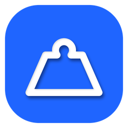
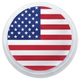
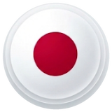
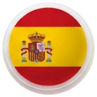

# 🌟 표준 앱 헤더 컴포넌트 킷 (App Header Component Kit)

다양한 엔지니어링 웹 애플리케이션(예: **HeatInput23**, **WCL**, 계측기 웹앱 등)에서 일관된 사용자 경험(UX)과 브랜드 디자인 아이덴티티를 유지할 수 있도록 독립 모듈화된 **표준 네비게이션 헤더 킷**입니다.

---

## 📸 헤더 배치 구성 (Layout)

```text
┌────────────────────────────────────────────────────────────────────────────────────────┐
│ [로고] 앱 타이틀 (전체 / 축약 자동전환)      [v1.0]  [Free/Pro]  [WiFi]  [🌙]  [🇰🇷▼]  [📖] │
└────────────────────────────────────────────────────────────────────────────────────────┘
```

1. **좌측 (Brand Wrap)**
   - **앱 로고 (`.app-logo-box`)**: 44×44px (모바일 30×30px) 고해상도 스퀘어클(Squircle) 아이콘
   - **반응형 타이틀 (`#appTitle`)**:
     - 넓은 화면(데스크톱): **전체 타이틀 (Full Title)** 표시
     - 좁은 화면(모바일 ≤ 768px): **축약 타이틀 (Short Title)**로 자동 전환 (말줄임표 잘림 방지)

2. **우측 (Header Actions)**
   - **`[v1.0]` 앱 버전 뱃지 (`.hdr-btn-ver`)**: Pro 좌측에 통일된 라운드 박스 테마로 배치
   - **`[Free / Pro]` 라이선스 뱃지 (`.hdr-btn-pro`)**: Free(그레이) / Pro(에메랄드 그린) 상태 자동 표시 및 클릭 시 모달 연동
   - **`[WiFi]` 통신 상태 뱃지 (`.hdr-btn-net`)**: 온라인(블루) / 오프라인(흐림) 자동 감지 (모바일 공간 확보를 위해 모바일에서는 자동 숨김)
   - **`[🌙]` 다크 모드 토글 (`#btnDarkMode`)**: 라이트/다크 테마 1클릭 전환 및 `localStorage` 자동 기억
   - **`[🇰🇷▼]` 원형 국기 언어 선택 (`.lang-dropdown-wrap`)**: 5개 국어(한국어, 영어, 스페인어, 중국어, 일본어) 원형 SVG 국기 및 플로팅 드롭다운
   - **`[📖]` 도움말/매뉴얼 버튼 (`#btnManual`)**: 표준 모달 다이얼로그 호출

---

## 📁 킷 파일 구성

```text
shared-header-kit/
├── index.html        # 단독 실행 가능한 인터랙티브 데모 페이지
├── header-kit.css    # 독립형 CSS (테마 변수, 모바일 반응형, 애니메이션 포함)
├── header-kit.js     # 순수 바닐라 JS 컨트롤러 (의존성 제로)
├── icons/            # 필수 아이콘 이미지
│   ├── app-logo.png  # 기본 앱 스퀘어클 로고
│   ├── flag_ko.png   # 한국 국기 원형 아이콘
│   ├── flag_en.png   # 미국/영문 국기 원형 아이콘
│   ├── flag_es.png   # 스페인 국기 원형 아이콘
│   ├── flag_zh.png   # 중국 국기 원형 아이콘
│   └── flag_ja.png   # 일본 국기 원형 아이콘
└── README.md         # 본 가이드 문서
```

---

## 🚀 다른 웹앱에 1분 만에 적용하는 방법 (Quick Integration)

### 1단계: 파일 복사
새 프로젝트 폴더에 `header-kit.css`, `header-kit.js`, `icons/` 폴더를 복사합니다.

### 2단계: `<head>`에 CSS 링크 추가
```html
<link rel="stylesheet" href="header-kit.css" />
```

### 3단계: `<body>` 최상단에 헤더 HTML 붙여넣기
```html
<header class="top-header">
  <div class="header-inner">
    <!-- 좌측 브랜드 (로고 및 전체/축약 타이틀) -->
    <div class="brand-wrap" onclick="window.scrollTo({top:0, behavior:'smooth'})">
      <div class="app-logo-box">
        
      </div>
      <div class="brand-text">
        <h1 id="appTitle">
          <span class="title-full">용접 입열량 및 냉각속도 계산기</span>
          <span class="title-short">입열량 계산기</span>
        </h1>
      </div>
    </div>

    <!-- 우측 일원화 컨트롤 -->
    <div class="header-actions">
      <!-- 1. 버전 번호 -->
      <span class="hdr-btn hdr-btn-ver" id="appVersionBadge">v1.0</span>

      <!-- 2. Pro/Free 라이선스 -->
      <button type="button" id="proBadge" class="hdr-btn hdr-btn-pro">Free</button>

      <!-- 3. WiFi 통신 상태 (오프라인 PWA 지원) -->
      <div id="netStatusBadge" class="hdr-btn hdr-btn-net online" title="Online Ready">
        <svg class="wifi-svg" viewBox="0 0 24 24" width="20" height="20" fill="currentColor">
          <path d="M12 18.5a1.8 1.8 0 1 1 0 3.6 1.8 1.8 0 0 1 0-3.6zm-4.3-3.2a6.1 6.1 0 0 1 8.6 0 .9.9 0 0 0 1.3-1.3 7.9 7.9 0 0 0-11.2 0 .9.9 0 0 0 1.3 1.3zm-2.9-2.9a10.2 10.2 0 0 1 14.4 0 .9.9 0 0 0 1.3-1.3 12 12 0 0 0-17 0 .9.9 0 0 0 1.3 1.3zm-2.9-2.9a14.3 14.3 0 0 1 20.2 0 .9.9 0 0 0 1.3-1.3 16.1 16.1 0 0 0-22.8 0 .9.9 0 0 0 1.3 1.3z"/>
        </svg>
      </div>

      <!-- 4. 다크 모드 토글 -->
      <button type="button" class="hdr-btn" id="btnDarkMode" title="다크 모드 전환">
        <svg viewBox="0 0 24 24" width="20" height="20" stroke="currentColor" stroke-width="2" fill="none">
          <path d="M20.985 12.486a9 9 0 1 1-9.473-9.472c.405-.022.617.46.402.803a6 6 0 0 0 8.268 8.268c.344-.215.825-.004.803.401"/>
        </svg>
      </button>

      <!-- 5. 원형 국기 언어 선택 드롭다운 -->
      <div class="lang-dropdown-wrap">
        <button type="button" class="hdr-btn lang-btn" id="btnLangDropdown">
          <span id="currentFlagIcon" class="flag-icon-circle">
            
          </span>
          <svg class="lang-caret" viewBox="0 0 10 6" width="8" height="6" fill="currentColor"><path d="M0 0l5 5 5-5z"/></svg>
        </button>
        <div id="langDropdownMenu" class="lang-dropdown-menu hidden">
          <button type="button" class="lang-item active" data-lang="ko">
            <span class="flag-icon-circle"></span>
            <span>한국어</span>
          </button>
          <button type="button" class="lang-item" data-lang="en">
            <span class="flag-icon-circle"></span>
            <span>English</span>
          </button>
          <button type="button" class="lang-item" data-lang="zh">
            <span class="flag-icon-circle"></span>
            <span>简体中文</span>
          </button>
          <button type="button" class="lang-item" data-lang="ja">
            <span class="flag-icon-circle"></span>
            <span>日本語</span>
          </button>
          <button type="button" class="lang-item" data-lang="es">
            <span class="flag-icon-circle"></span>
            <span>Español</span>
          </button>
        </div>
      </div>

      <!-- 6. 도움말 버튼 -->
      <button type="button" class="hdr-btn" id="btnManual" title="도움말">
        <svg viewBox="0 0 24 24" width="20" height="20" stroke="currentColor" stroke-width="2" fill="none">
          <path d="M4 19.5A2.5 2.5 0 0 1 6.5 17H20"/>
          <path d="M6.5 2H20v20H6.5A2.5 2.5 0 0 1 4 19.5v-15A2.5 2.5 0 0 1 6.5 2z"/>
        </svg>
      </button>
    </div>
  </div>
</header>
```

### 4단계: 스크립트 로드 및 초기화
```html
<script src="header-kit.js"></script>
<script>
  HeaderKit.init({
    version: "v1.0",           // 버전 번호
    isPro: false,              // Pro 활성화 여부
    defaultLang: "ko",         // 기본 언어
    onThemeChange: (theme) => {
      console.log("테마 변경됨:", theme); // "light" or "dark"
    },
    onLanguageChange: (lang) => {
      console.log("언어 변경됨:", lang);   // "ko", "en", "zh", "ja", "es"
      // 타이틀 변경 예시:
      // HeaderKit.setTitle("전체 타이틀", "축약 타이틀");
    },
    onLicenseClick: (isPro) => {
      // 라이선스 모달 호출
    },
    onHelpClick: () => {
      // 설명서 모달 호출
    }
  });
</script>
```

---

## 🛠️ JavaScript API 레퍼런스

| 메서드 | 설명 | 예제 |
| :--- | :--- | :--- |
| `HeaderKit.init(options)` | 헤더 컨트롤러 초기화 및 이벤트 바인딩 | `HeaderKit.init({ version: 'v2.0' })` |
| `HeaderKit.setTheme(theme)` | 테마 강제 변경 (`'light'` 또는 `'dark'`) | `HeaderKit.setTheme('dark')` |
| `HeaderKit.setLanguage(lang)` | 언어 강제 변경 및 국기 동기화 | `HeaderKit.setLanguage('en')` |
| `HeaderKit.setLicense(isPro)` | Pro / Free 상태 토글 및 색상 변경 | `HeaderKit.setLicense(true)` |
| `HeaderKit.setVersion(text)` | 버전 뱃지 텍스트 변경 | `HeaderKit.setVersion('v2.3.1')` |
| `HeaderKit.setTitle(full, short)` | 전체/축약 타이틀 동시 설정 | `HeaderKit.setTitle('전체 이름', '축약')` |
| `HeaderKit.updateNetworkStatus()` | 온라인/오프라인 WiFi 상태 갱신 | `HeaderKit.updateNetworkStatus()` |

---

## 🎨 커스텀 테마 색상 (CSS Variables)
`header-kit.css` 상단의 CSS 변수를 수정하여 앱의 고유 브랜드 컬러로 손쉽게 커스텀할 수 있습니다.
```css
:root {
  --hdr-primary: #2563eb;      /* 메인 포인트 블루 */
  --hdr-success: #059669;      /* Pro 뱃지 그린 */
  --hdr-wifi-blue: #4686b8;    /* WiFi 활성 블루 */
  --hdr-bg-header: rgba(255, 255, 255, 0.95);
}
```
